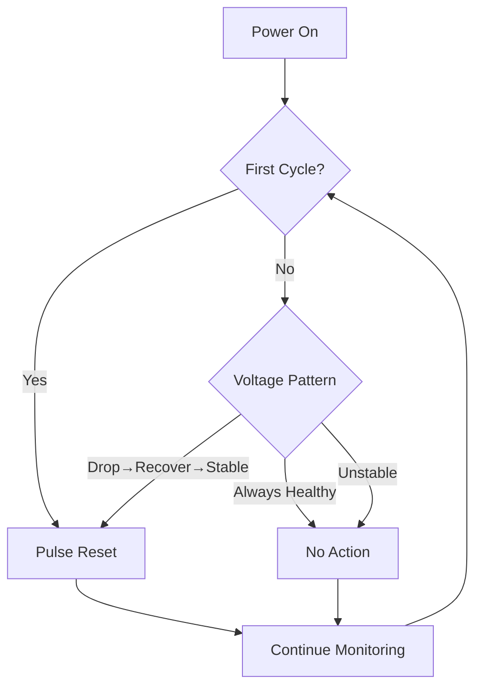

# Meshtastic Watcher

An ultra-low-power watchdog device that automatically recovers solar-powered Meshtastic nodes after deep battery discharge. Built with MSP430 microcontroller for minimal power consumption.

---

## Problem Statement

Solar-powered Meshtastic Heltec V3 nodes fail to automatically rejoin the mesh network after complete battery discharge (brownout), even when the battery has fully recharged. Investigation of the Meshtastic source code indicates the device does not self-wake after brownout events.

**Observed behavior:**
- Extended cloudy weather depletes battery completely
- Node enters brownout and shuts down
- Solar panel recharges battery to normal levels
- Node remains unresponsive (verified with multimeter showing adequate voltage)
- User button press has no effect
- Only reset button successfully restores operation

This creates a maintenance burden for remote installations (rooftops, towers, etc.).

---

## Solution Approach

An MSP430-based monitoring device continuously tracks battery voltage and triggers reset only when true brownout recovery is detected. 

The design evolved through several iterations. Initially, a simple periodic reset was considered but rejected—it would interrupt active transmissions and make nodes appear unreliable on the mesh map. A threshold-based approach was next, but it couldn't distinguish whether voltage was rising to a safe level or already stable. The final solution uses hysteresis-based pattern detection: the watchdog monitors for the complete signature of voltage drop, recovery, and stability before acting. This ensures resets occur only when evidence of brownout recovery exists, avoiding unnecessary interventions.

The device always pulses once during its first evaluation cycle. This handles the edge case of initial deployment or testing where the system state is unknown, and ensures the Meshtastic node starts from a clean state regardless of how the watchdog was powered on.

## Key features

- **Ultra-low power**: Sleeps most of the time, using about 0.1 microamps—that's less power than a watch battery loses by sitting on a shelf
- **Intelligent monitoring**: Checks battery health 2,880 times per day but only acts when needed
- **Safe operation**: Uses open-drain output (like a gentle tap, not a forced push)
- **Self-contained**: No external components needed for basic operation
- **Adjustable**: All thresholds and timings can be customized in the code

---

## Operation Logic

The watchdog continuously monitors battery voltage and makes reset decisions based on observed patterns over time.



**Three possible voltage patterns:**

1. **Healthy** - Voltage remains stable throughout the cycle → No reset needed
2. **Brownout recovery** - Voltage drops, then recovers and stabilizes → Reset triggered
3. **Unstable** - Voltage drops and recovers but drops again → Wait for better stability

The unstable pattern indicates the battery doesn't have sufficient charge yet. Waiting another cycle allows more solar charging time before attempting node recovery.

**Note on voltage monitoring:** The system measures input supply voltage (what powers the MSP430), not raw battery voltage. Since the MSP430 operates down to 1.8V while Meshtastic nodes require 3.3V regulation, the watchdog outlasts the node during brownout conditions. If battery protection circuitry disconnects power at critical levels, both devices lose power; when solar recharging restores voltage, the MSP430 restarts and triggers recovery.

---

## Hardware Implementation

### Overview

This is a handcrafted solution built on perforated prototyping board for small-scale deployment (2-3 units). The design uses an MSP430G2553 microcontroller with its internal ADC for voltage monitoring and ultra-low power operation down to 1.8V. The compact form factor fits behind the Meshtastic node inside typical outdoor enclosures.

### Components

- **MSP430G2553** microcontroller (20-pin DIP package)
- **10µF electrolytic capacitor** (power supply stabilization)
- **47kΩ resistor + 100nF ceramic capacitor** (RC reset circuit on MSP430 RST pin)
- **Pin headers** (programming interface: RST, TEST, P1.1, P1.2)
- **Perforated prototype board**

### Pinout & Connections

```
MSP430G2553 → Meshtastic Heltec V3
━━━━━━━━━━━━━━━━━━━━━━━━━━━━━━━━━━
VCC (Pin 1)   → 3.3V supply (shared with Meshtastic node)
GND           → GND
P1.4 (Pin 7)  → Pin 0 (RESET) on Heltec V3

MSP430 RST Circuit:
━━━━━━━━━━━━━━━━━━━━
RST (Pin 16) ──┬── 47kΩ ───── VCC
               └── 100nF ── GND

Programming Interface (headers only, not connected to node):
━━━━━━━━━━━━━━━━━━━━━━━━━━━━━━━━━━━━━━━━━━━━━━━━━━━━━━━━━
RST/SBWTDIO (Pin 16) ─┐
TEST/SBWTCK (Pin 17) ─┤
P1.1 (Pin 2, UART TX)─├─ Connect to MSP430 LaunchPad for flashing/debug
P1.2 (Pin 3, UART RX)─┤   TX→RX, RX→TX, TEST→TEST, RST→RST
VCC, GND ─────────────┘
```

**Power Source:** MSP430 VCC connected to same supply as Meshtastic node.
10µF capacitor provides power stability during ADC measurements and pulse events. MSP430 operates down to 1.8V, remaining functional during brownout when node shuts down at ~3.0V.

**Reset Connection:** P1.4 configured as open-drain output (pulls LOW during pulse, Hi-Z otherwise). Heltec V3 has internal pull-up on RESET line, no external resistor needed.

**RC Reset Circuit:** Prevents MSP430 from entering undefined states during power-up. 47kΩ weak pull-up and 100nF capacitor provide clean reset timing.

**Programming Interface:** Headers expose Spy-Bi-Wire (RST/TEST) and UART (P1.1/P1.2) for flashing and debugging. Not connected to Meshtastic node during normal operation.

### Testing Setup

For initial testing, use a standard **MSP430 LaunchPad** evaluation board:
1. Connect LaunchPad pins to watchdog headers: TX→RX, RX→TX, TEST→TEST, RST→RST, VCC, GND
2. Flash firmware via LaunchPad
3. Connect watchdog VCC/GND to Meshtastic node power supply
4. Connect watchdog P1.4 → Meshtastic Pin 0 (RESET)
5. Verify reset pulse on power-on (~12h after deployment)

---

## Software Setup

### Build Environment

**Required tools:**
- [Visual Studio Code](https://code.visualstudio.com/)
- [PlatformIO extension](https://platformio.org/) for VS Code
- MSP430 programmer (LaunchPad or compatible)

PlatformIO automatically handles toolchain installation, compiler setup, and library management.

### Installation

**1. Install VS Code and PlatformIO extension**

**2. Clone repository**
```bash
git clone https://github.com/Mickyleitor/meshtastic_watcher.git
cd meshtastic_watcher
```

**3. Open project in VS Code**
- File → Open Folder → Select `meshtastic_watcher`
- PlatformIO auto-detects project configuration

**4. Build firmware**
```bash
pio run
```

**5. Flash to MSP430**
```bash
pio run --target upload
```

Firmware begins operation immediately after upload.

---

## Configuration

All configurable parameters are located at the top of `src/main.c` with detailed comments explaining each setting:

- Evaluation period (decision window timing)
- Voltage thresholds (low and recovery levels with hysteresis)
- Pulse duration
- Pin assignments
- Check frequency

Modify values as needed, rebuild (`pio run`), and upload (`pio run --target upload`).

---

## Notes

**Timing precision:** Internal VLO oscillator varies ±10% with temperature and voltage. Sufficient for this application (non-critical timing).

**Voltage measurement:** Internal ADC reference has ±5% tolerance. Thresholds can be calibrated per device if higher accuracy needed.

**Power consumption:** Device spends >99.99% of time in LPM3 (<1µA). Negligible impact on solar/battery system.

**Scope:** This is a targeted solution for a specific deployment scenario. Designed for small-scale production (2-3 units).

---

## License

MIT License - See [LICENSE](LICENSE) for details.
