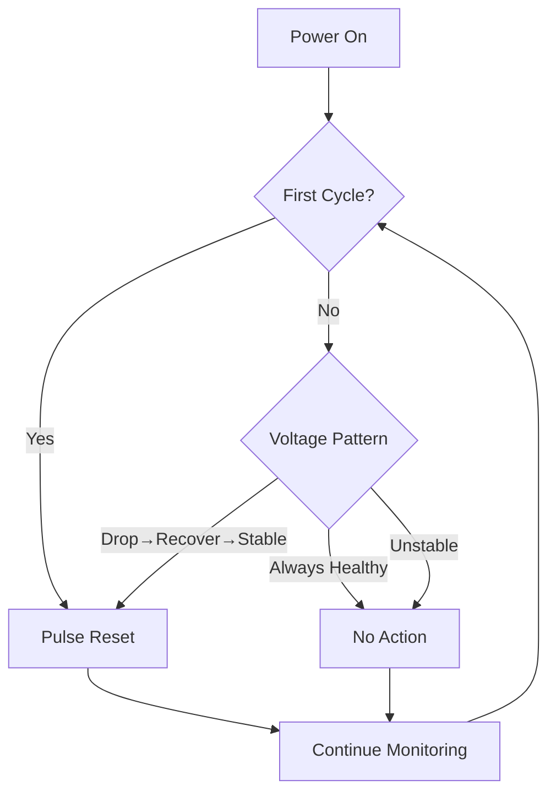
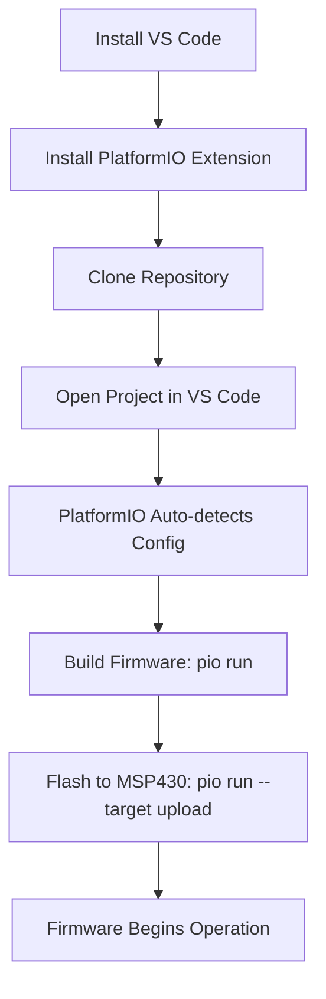

# Wiki Documentation for /app/repo/meshtastic_watcher

Generated on: 2026-01-23 00:02:33

## Table of Contents

- [Project Overview](#page-1)
- [System Operation Logic and Workflow](#page-2)
- [Hardware Design and Connections](#page-3)
- [Software Setup and Customization](#page-4)

<a id='page-1'></a>

## Project Overview

### Related Pages

Related topics: [System Operation Logic and Workflow](#page-2), [Hardware Design and Connections](#page-3)

<details>
<summary>Relevant source files</summary>

- [README.md](README.md)
- [src/main.c](src/main.c)
- [LICENSE](LICENSE)
- [platformio.ini](platformio.ini)
- [src/config.h](src/config.h)
</details>

# Project Overview

The Meshtastic Watcher is an ultra-low-power embedded system designed to automatically recover solar-powered Meshtastic nodes, specifically Heltec V3, after deep battery discharge events (brownout). Its primary purpose is to address the issue where Meshtastic nodes fail to self-wake and rejoin the mesh network even after their batteries have fully recharged, necessitating manual intervention for remote installations. The system operates by intelligently monitoring the supply voltage and issuing a reset pulse only when a brownout recovery pattern is detected, ensuring minimal power consumption and avoiding unnecessary interruptions to node operation.
Sources: [README.md:1-12, 45-53]()

This watchdog device is built around an MSP430G2553 microcontroller, leveraging its internal Analog-to-Digital Converter (ADC) for voltage measurements and ultra-low-power modes. It functions as a self-contained unit, requiring no external components for its core operation, and is highly configurable through its firmware. The design prioritizes low power consumption, intelligent decision-making, and safe interaction with the Meshtastic node.
Sources: [src/main.c:1-10](), [README.md:6-12, 59-62, 102-105]()

## Problem Statement

Solar-powered Meshtastic Heltec V3 nodes exhibit a critical failure mode: after complete battery discharge (brownout), they do not automatically rejoin the mesh network even once the battery has fully recharged. This behavior has been observed to render nodes unresponsive, requiring a physical reset button press to restore operation. Such a requirement creates a significant maintenance burden, particularly for remote installations where manual access is difficult or impossible.
Sources: [README.md:33-43]()

## Solution Approach

The Meshtastic Watcher implements an MSP430-based monitoring device that continuously tracks the input supply voltage to the Meshtastic node. The solution evolved from simpler approaches (periodic reset, simple threshold) to a sophisticated hysteresis-based pattern detection mechanism. This ensures resets are triggered only when a complete signature of voltage drop, recovery, and subsequent stability is observed, thereby avoiding unnecessary interruptions to node operation. Additionally, the device performs an initial reset pulse during its first evaluation cycle to guarantee a clean startup for the Meshtastic node, regardless of the watchdog's power-on state.
Sources: [README.md:45-53, 63-66](), [src/main.c:5-6, 116]()

### Key Features

The Meshtastic Watcher is designed with several core features to provide reliable and efficient brownout recovery:

| Feature               | Description                                                                                                                                |
| :-------------------- | :----------------------------------------------------------------------------------------------------------------------------------------- |
| **Ultra-low power**   | Sleeps most of the time, consuming approximately 0.1 microamps, minimizing impact on solar/battery systems.                                 |
| **Intelligent monitoring** | Checks battery health 2,880 times per day (based on 30-second wakeup interval) and only acts when a brownout recovery pattern is detected. |
| **Safe operation**    | Uses an open-drain output for the reset pulse, acting as a gentle tap rather than a forced push.                                            |
| **Self-contained**    | Requires no external components for basic operation, simplifying deployment.                                                                |
| **Adjustable**        | All critical thresholds and timings are customizable directly in the source code.                                                          |
Sources: [README.md:55-62](), [src/main.c:2-3, 16-29]()

## Operation Logic

The watchdog continuously monitors the supply voltage and makes reset decisions based on observed patterns over defined evaluation windows.

### High-Level Decision Flow

The following diagram illustrates the high-level operational logic:


Sources: [README.md:70-79]()

**Voltage Patterns:**
The system distinguishes between three primary voltage patterns:
1.  **Healthy:** Voltage remains stable throughout the cycle; no reset is needed.
2.  **Brownout recovery:** Voltage drops below a low threshold, then recovers and stabilizes above a stable threshold; a reset is triggered.
3.  **Unstable:** Voltage drops and recovers but drops again, or does not stabilize sufficiently; the system waits for better stability in the next cycle.
Sources: [README.md:81-88]()

The system measures the input supply voltage to the MSP430, which is shared with the Meshtastic node. The MSP430 can operate down to 1.8V, outlasting the Meshtastic node which typically requires 3.3V regulation. This allows the watchdog to remain functional during brownout conditions when the node has already shut down.
Sources: [README.md:90-94]()

### Main Loop Execution Flow

The core operational logic is implemented in the `main` function, which orchestrates initialization, periodic voltage checks, and reset decisions.

```mermaid
graph TD
    A[main() Initialization] --> B[Enter LPM3 (Wait for 30s Timer Tick)]
    B --> C[Read VCC (adc10_read_vcc_mv)]
    C --> D{VCC < VCC_LOW_THRESHOLD?}
    D -- Yes --> E[Set vcc_low_seen = 1]
    D -- No --> F{VCC >= VCC_STABLE_THRESHOLD?}
    F -- Yes --> G[Set vcc_enough_now = 1]
    F -- No --> H[Set vcc_enough_now = 0]
    E --> I[Update vcc_lowest_seen]
    G --> I
    H --> I
    I --> J[Increment elapsed_sec by BASE_PERIOD_S]
    J --> K{Evaluation Window Elapsed? (elapsed_sec >= PULSE_INTERVAL_MIN * 60)}
    K -- Yes --> L{Pulse Condition Met? (first_window OR (vcc_low_seen AND vcc_enough_now))}
    L -- Yes --> M[Call do_pulse()]
    M --> N[Reset vcc_low_seen = 0, how_many_pulses++, first_window = 0, elapsed_sec = 0]
    N --> B
    L -- No --> N
    K -- No --> B
```
Sources: [src/main.c:115-150]()

### ADC Voltage Measurement

The `adc10_read_vcc_mv` function performs the voltage measurement using the MSP430's internal ADC.

```mermaid
graph TD
    A[adc10_read_vcc_mv()] --> B[Configure ADC10 for VCC/2 channel, 2.5V Ref, ADC10ON, REFON]
    B --> C[Delay cycles for reference stabilization]
    C --> D[Enable Conversion (ENC) & Start (ADC10SC)]
    D --> E[Wait for ADC10BUSY to clear]
    E --> F[Read ADC10MEM]
    F --> G[Disable ADC (ENC, ADC10ON, REFON)]
    G --> H[Calculate VCC in mV: (adc * 5000 + 511) / 1023]
    H --> I[Clamp VCC_mv to 65535 if > 65535]
    I --> J[Return vcc_mv]
```
Sources: [src/main.c:94-113]()

## Hardware Implementation

### Overview

The Meshtastic Watcher is implemented as a handcrafted solution on a perforated prototyping board, suitable for small-scale deployments. It uses an MSP430G2553 microcontroller for its low-power capabilities and integrated ADC. The compact design allows it to fit behind a Meshtastic node within typical outdoor enclosures.
Sources: [README.md:102-107]()

### Components

The system relies on a minimal set of components:

| Component                       | Description                                                     |
| :------------------------------ | :-------------------------------------------------------------- |
| MSP430G2553 microcontroller     | 20-pin DIP package, core logic.                                 |
| 10µF electrolytic capacitor     | Provides power supply stabilization.                            |
| 47kΩ resistor + 100nF ceramic capacitor | Forms an RC reset circuit on the MSP430's RST pin.              |
| Pin headers                     | Used for programming interface (RST, TEST, P1.1, P1.2).         |
| Perforated prototype board      | Base for component assembly.                                    |
Sources: [README.md:109-114]()

### Pinout & Connections

The MSP430G2553 interfaces with the Meshtastic Heltec V3 node and its own programming interface as follows:

*   **MSP430G2553 → Meshtastic Heltec V3:**
    *   VCC (Pin 1) → 3.3V supply (shared with Meshtastic node)
    *   GND → GND
    *   P1.4 (Pin 7) → Pin 0 (RESET) on Heltec V3
*   **MSP430 RST Circuit:**
    *   RST (Pin 16) ──┬── 47kΩ ───── VCC
    *   &nbsp;&nbsp;&nbsp;&nbsp;&nbsp;&nbsp;&nbsp;&nbsp;&nbsp;&nbsp;&nbsp;&nbsp;&nbsp;&nbsp;&nbsp;└── 100nF ── GND
*   **Programming Interface (headers only):**
    *   RST/SBWTDIO (Pin 16) ─┐
    *   TEST/SBWTCK (Pin 17) ─┤
    *   P1.1 (Pin 2, UART TX)─├─ Connect to MSP430 LaunchPad for flashing/debug
    *   P1.2 (Pin 3, UART RX)─┤   (TX→RX, RX→TX, TEST→TEST, RST→RST)
    *   VCC, GND ─────────────┘
Sources: [README.md:118-135]()

**Details:**
*   **Power Source:** The MSP430's VCC is connected to the same supply as the Meshtastic node. A 10µF capacitor stabilizes power. The MSP430's low operating voltage (down to 1.8V) allows it to function during brownout conditions when the node (requiring ~3.0V) has already shut down.
*   **Reset Connection:** P1.4 is configured as an open-drain output, pulling LOW during a pulse and becoming Hi-Z otherwise. The Heltec V3's internal pull-up on its RESET line eliminates the need for an external resistor.
*   **RC Reset Circuit:** A 47kΩ weak pull-up resistor and 100nF capacitor on the MSP430's RST pin ensure a clean reset timing and prevent undefined states during power-up.
Sources: [README.md:137-147](), [src/main.c:75-78]()

### GPIO Low-Power Initialization

The `gpio_init_lowpower` function configures all unused pins as inputs with pull-downs to minimize leakage, except for the `PULSE_PIN_BIT` and `DBG_PIN_BIT`.

```mermaid
graph TD
    A[gpio_init_lowpower()] --> B[Phase 1: All pins Hi-Z]
    B --> C[Clear P1SEL, P1SEL2, P2SEL, P2SEL2 (GPIO mode)]
    C --> D[Clear P1DIR, P2DIR (Inputs)]
    D --> E[Clear P1REN, P2REN (No internal pulls)]
    E --> F[Phase 2: Low-leakage config]
    F --> G[Define KEEP_HIZ_P1 (PULSE_PIN_BIT | DBG_PIN_BIT)]
    G --> H[Define P1_PULL_MASK (~KEEP_HIZ_P1)]
    H --> I[Set P1OUT (pull-down for P1_PULL_MASK)]
    I --> J[Set P2OUT = 0x00 (all P2 pulls down)]
    J --> K[Enable P1REN for P1_PULL_MASK]
    K --> L[Enable P2REN for 0xFF (all P2 pins)]
    L --> M[DIR remains 0 (all inputs)]
```
Sources: [src/main.c:50-71]()

## Software Setup

### Build Environment

The project utilizes Visual Studio Code with the PlatformIO extension for its build environment. PlatformIO simplifies toolchain installation, compiler setup, and library management for embedded development. An MSP430 programmer (e.g., MSP430 LaunchPad) is required for flashing the firmware.
Sources: [README.md:151-155]()

### Installation

To set up and install the firmware:

1.  Install Visual Studio Code and the PlatformIO extension.
2.  Clone the repository: `git clone https://github.com/Mickyleitor/meshtastic_watcher.git` and navigate into the `meshtastic_watcher` directory.
3.  Open the project in VS Code (File → Open Folder → Select `meshtastic_watcher`). PlatformIO will automatically detect the project configuration (implicitly from `platformio.ini` for build settings).
4.  Build the firmware using the PlatformIO CLI: `pio run`.
5.  Flash the firmware to the MSP430 microcontroller: `pio run --target upload`.
The firmware begins operation immediately after upload.
Sources: [README.md:157-168](), [platformio.ini]()

### Configuration

All configurable parameters are located at the top of `src/main.c` within the `CONFIGURATION` section. These settings allow customization of the watchdog's behavior to suit specific deployment needs.
Sources: [README.md:170-172](), [src/main.c:16]()

| Parameter             | Description                                                                 | Default Value (src/main.c) |
| :-------------------- | :-------------------------------------------------------------------------- | :------------------------- |
| `PULSE_INTERVAL_MIN`  | Evaluation window duration in minutes (converted to 30s ticks).             | `60 * 12` (12 hours)       |
| `BASE_PERIOD_S`       | Wakeup interval for voltage evaluation in seconds.                          | `30u`                      |
| `PULSE_MS`            | Duration of the reset pulse in milliseconds.                                | `500u`                     |
| `VCC_LOW_THRESHOLD_MV` | Voltage (mV) below which brownout is detected.                              | `2900u`                    |
| `VCC_STABLE_THRESHOLD_MV` | Voltage (mV) above which recovery is confirmed (hysteresis).                | `3100u`                    |
| `PULSE_PIN_BIT`       | GPIO pin bit for the Meshtastic reset output (P1.4).                        | `BIT4`                     |
| `DBG_PIN_BIT`         | GPIO pin bit for debug UART TX (P1.3).                                      | `BIT3`                     |
| `ACLK_VLO_HZ`         | Nominal frequency of the VLO oscillator for ACLK.                           | `12000u`                   |
| `TIMER_DIV`           | Timer_A divider for clock source.                                           | `8u`                       |
Sources: [src/main.c:18-29](), [src/config.h]()

## Technical Notes

*   **Timing Precision:** The internal VLO oscillator, used for ACLK, has a nominal frequency of 12kHz but can vary by ±10% with temperature and voltage. This level of precision is deemed sufficient for the non-critical timing requirements of this application.
*   **Voltage Measurement:** The internal ADC reference (2.5V) has a ±5% tolerance. For applications requiring higher accuracy, per-device calibration of voltage thresholds may be necessary.
*   **Power Consumption:** The device spends over 99.99% of its operational time in LPM3 (Low Power Mode 3), resulting in an average current consumption of less than 1µA. This minimal power draw has a negligible impact on the overall solar/battery system.
*   **Scope:** The Meshtastic Watcher is a targeted solution designed for a specific deployment scenario, intended for small-scale production (2-3 units).
Sources: [README.md:180-193]()

## License

This project is released under the MIT License.
Sources: [README.md:195](), [LICENSE]()

## Conclusion

The Meshtastic Watcher provides an effective, ultra-low-power solution to a critical operational issue for solar-powered Meshtastic nodes. By intelligently monitoring battery voltage and triggering resets only when a brownout recovery pattern is confirmed, it ensures remote nodes can reliably self-recover and rejoin the mesh network without manual intervention, thereby reducing maintenance overhead and improving system resilience.
Sources: [README.md:1-12, 45-53]()

---

<a id='page-2'></a>

## System Operation Logic and Workflow

### Related Pages

Related topics: [Project Overview](#page-1), [Hardware Design and Connections](#page-3), [Software Setup and Customization](#page-4)

<details>
<summary>Relevant source files</summary>

- [README.md](README.md)
- [src/main.c](src/main.c)
- [LICENSE](LICENSE)
- [platformio.ini](platformio.ini)
- [msp430.h](msp430.h)
</details>

# System Operation Logic and Workflow

The Meshtastic Watcher is an ultra-low-power watchdog device designed to automatically recover solar-powered Meshtastic nodes after deep battery discharge. It addresses the problem where Meshtastic Heltec V3 nodes fail to automatically rejoin the mesh network following a complete battery brownout, even after the battery has recharged. The system operates by continuously monitoring the supply voltage and intelligently triggering a reset pulse only when a brownout recovery pattern is detected, ensuring reliable operation of remote Meshtastic installations. Sources: [README.md:1-12](), [README.md:18-20]()

The core logic is implemented on an MSP430 microcontroller, chosen for its minimal power consumption, allowing the watchdog to operate with an average power draw of less than 1µA. This intelligent monitoring prevents unnecessary resets that could interrupt active transmissions, making the node appear unreliable. Sources: [README.md:21-32](), [src/main.c:1-8]()

## System Architecture and Components

The Meshtastic Watcher is built around an MSP430G2553 microcontroller. It utilizes the microcontroller's internal ADC for voltage monitoring and operates down to 1.8V, outlasting the Meshtastic node during brownout conditions. The device requires no external components for its basic operation. Sources: [README.md:92-95](), [src/main.c:1-8]()

Key hardware components and their roles include:
- **MSP430G2553 Microcontroller**: The central processing unit for monitoring and control. Sources: [README.md:98]()
- **Internal ADC**: Used for accurate supply voltage measurements, specifically the VCC/2 channel with a 2.5V internal reference. Sources: [src/main.c:5-6](), [src/main.c:116]()
- **Open-drain output on P1.4**: Designated as `PULSE_PIN_BIT`, this pin is used to generate the reset pulse for the Meshtastic node. It pulls LOW during a pulse and is Hi-Z otherwise. Sources: [src/main.c:6](), [src/main.c:31]()
- **VLO Oscillator**: The internal Very Low-frequency Oscillator (~12kHz) drives Timer_A for periodic wakeups from low-power modes. Sources: [src/main.c:7](), [src/main.c:35]()
- **GPIO Configuration**: All unused pins are configured as inputs with pull-downs to minimize leakage, ensuring ultra-low power consumption. Sources: [src/main.c:8](), [src/main.c:64-79]()

## Power Management and Clocking

The system is designed for ultra-low power consumption, spending over 99.99% of its time in Low Power Mode 3 (LPM3). This results in an average power consumption of less than 1µA. Sources: [README.md:46](), [README.md:175](), [src/main.c:9-10]()

### Clock Initialization
The `clocks_init` function configures the clock system:
- `ACLK` (Auxiliary Clock) is sourced from the VLO (Very Low-frequency Oscillator), which runs in LPM3.
- `MCLK` (Master Clock) and `SMCLK` (Sub-Master Clock) are set to 1MHz using factory calibrated values if available, providing the necessary speed for ADC measurements and pulse generation.
Sources: [src/main.c:46-51]()

### Low-Power GPIO Configuration
The `gpio_init_lowpower` function ensures minimal leakage:
1.  All pins are initially configured as plain GPIO inputs without internal pull-ups/downs or alternate functions. Sources: [src/main.c:56-62]()
2.  In the second phase, all pins except `PULSE_PIN_BIT` (P1.4) and `DBG_PIN_BIT` (P1.3) are configured with internal pull-downs to minimize leakage. The `PULSE_PIN_BIT` is left as true Hi-Z (no internal pull) to support open-drain operation. Sources: [src/main.c:64-79]()

## Voltage Monitoring Logic

The system continuously monitors the input supply voltage (VCC) using the MSP430's internal 10-bit ADC. This allows the watchdog to remain functional during brownout conditions when the Meshtastic node, requiring 3.3V regulation, might have already shut down. Sources: [README.md:79-84](), [src/main.c:5-6]()

### ADC Voltage Reading
The `adc10_read_vcc_mv` function performs the voltage measurement:
1.  Configures the ADC to use the VCC/2 channel (`INCH_11`) and an internal 2.5V reference (`SREF_1 | REF2_5V`). Sources: [src/main.c:116-117]()
2.  A short delay ensures the reference stabilizes. Sources: [src/main.c:118]()
3.  The ADC conversion is started (`ENC | ADC10SC`) and waits for completion. Sources: [src/main.c:119]()
4.  The raw ADC value is read from `ADC10MEM`. Sources: [src/main.c:120]()
5.  The ADC is then powered down to conserve energy (`~(ENC | ADC10ON | REFON)`). Sources: [src/main.c:121]()
6.  The raw ADC value is converted to millivolts (mV) using the formula: `VCC = (adc * 5000mV) / 1023` (since VCC/2 is measured against a 2.5V reference, full scale represents 5V). Sources: [src/main.c:123]()

### Voltage Thresholds
The system defines two key voltage thresholds for hysteresis-based detection:
- `VCC_LOW_THRESHOLD_MV`: Set to `2900u` (2.9V). If the measured VCC falls below this, a brownout condition is considered "seen". Sources: [src/main.c:28](), [src/main.c:155]()
- `VCC_STABLE_THRESHOLD_MV`: Set to `3100u` (3.1V). If the measured VCC rises above this, a recovery is considered "confirmed". Sources: [src/main.c:29](), [src/main.c:157]()

## Reset Triggering Mechanism

The watchdog's core logic involves a hysteresis-based pattern detection to trigger a reset. It pulses the Meshtastic node's reset line only when a specific brownout recovery pattern is observed: voltage drop → recovery → stable. Sources: [README.md:65](), [src/main.c:134]()

### Operation Logic Flow
The overall operation logic, including power-on and monitoring cycles, is depicted below:


Sources: [README.md:60-72]()

### Main Loop Logic
The `main` function orchestrates the monitoring and reset logic:
1.  **Initialization**: Watchdog timer is held, clocks are set up, GPIO configured for low power, and Timer_A initialized for periodic wakeups. Interrupts are enabled. Sources: [src/main.c:136-140]()
2.  **State Variables**:
    - `elapsed_sec`: Tracks elapsed time since the last evaluation window.
    - `first_window`: A flag that is `1` for the very first evaluation cycle, ensuring a pulse on startup. Sources: [src/main.c:142](), [README.md:40-42]()
    - `vcc_low_seen`: A sticky flag set to `1` if VCC drops below `VCC_LOW_THRESHOLD_MV`. It is cleared only after a reset pulse. Sources: [src/main.c:143](), [src/main.c:166]()
    - `vcc_enough_now`: A transient flag set to `1` if VCC is currently above `VCC_STABLE_THRESHOLD_MV`. Sources: [src/main.c:153](), [src/main.c:157]()
3.  **Sleep and Wakeup**: The system enters LPM3, waking up periodically via the `TIMER0_A0_ISR` which sets `tick_30s`. Sources: [src/main.c:149-152]()
4.  **Voltage Evaluation**: Upon wakeup, `adc10_read_vcc_mv()` is called to get the current voltage. `vcc_low_seen` and `vcc_enough_now` flags are updated based on thresholds. Sources: [src/main.c:153-159]()
5.  **Evaluation Window**: Every `PULSE_INTERVAL_MIN` (12 hours), the system checks if a reset is needed. Sources: [src/main.c:24](), [src/main.c:162]()
6.  **Reset Condition**: A reset pulse is triggered if `first_window` is `1` OR (`vcc_low_seen` is `1` AND `vcc_enough_now` is `1`). Sources: [src/main.c:163-164]()
7.  **Pulse Execution**: If triggered, `do_pulse()` is called. `vcc_low_seen` is cleared, and `first_window` is reset. Sources: [src/main.c:165-166]()

### Reset Pulse Generation
The `do_pulse` function generates the physical reset signal:
1.  Sets `P1OUT` for `PULSE_PIN_BIT` to LOW and configures `P1DIR` to output, effectively pulling the Meshtastic reset line LOW. Sources: [src/main.c:98-99]()
2.  Calls `delay_ms()` for `PULSE_MS` (500ms) to maintain the reset state. Sources: [src/main.c:26](), [src/main.c:100]()
3.  Resets `P1DIR` for `PULSE_PIN_BIT` to input, returning the pin to a Hi-Z state. The Heltec V3's internal pull-up then restores the HIGH state on its RESET line. Sources: [src/main.c:101](), [README.md:118]()

## Timing and Scheduling

The watchdog's operations are precisely timed to ensure intelligent monitoring without excessive power consumption.

### Timer_A Configuration
The `timerA_init_30s` function sets up Timer_A for periodic wakeups:
- `TACTL`: Configured to use `ACLK` (VLO) as the clock source (`TASSEL_1`), with an input divider of 8 (`ID_3`), and cleared (`TACLR`). Sources: [src/main.c:83]()
- `TACCR0`: Set to `CCR0_30S`, which is calculated to trigger an interrupt approximately every `BASE_PERIOD_S` (30 seconds). The calculation is `(BASE_PERIOD_S * TIMER_HZ - 1u)`. Sources: [src/main.c:37](), [src/main.c:84]()
- `TACCTL0`: Enables the Capture/Compare Interrupt for CCR0 (`CCIE`). Sources: [src/main.c:85]()
- `TACTL`: Set to `MC_1` (UP mode), meaning the timer counts from 0 to `TACCR0`. Sources: [src/main.c:86]()

### Interrupt Service Routine (ISR)
The `TIMER0_A0_ISR` is triggered by Timer_A's CCR0 match:
1.  Sets the `tick_30s` volatile flag to `1`, signaling a new 30-second interval has passed. Sources: [src/main.c:129]()
2.  Exits LPM3 by clearing `LPM3_bits` from the Status Register (`__bic_SR_register_on_exit(LPM3_bits)`), allowing the CPU to resume execution in the `main` loop. Sources: [src/main.c:130]()

### Evaluation Window
The system evaluates the voltage pattern and decides on a reset every `PULSE_INTERVAL_MIN` (720 minutes or 12 hours). This period allows sufficient time for solar charging to restore battery levels before attempting node recovery. Sources: [src/main.c:24](), [src/main.c:162]()

## Debugging Features

The Meshtastic Watcher includes a basic debugging output capability via a software UART.

### Debug Print Function
The `dbg_print` function allows sending arbitrary byte data over `DBG_PIN_BIT` (P1.3) as a serial signal:
- Configures `DBG_PIN_BIT` as an output and pulls it HIGH initially. Sources: [src/main.c:108-109]()
- Sends each byte as an 8N1 serial frame (1 start bit, 8 data bits, 1 stop bit). Sources: [src/main.c:111]()
- Bit timing is controlled by `BIT_CYCLES` (17 cycles, approximately 57600 baud at 1MHz MCLK). Sources: [src/main.c:106]()
- After transmission, the pin returns to a Hi-Z state (input). Sources: [src/main.c:70](), [src/main.c:121]()

## Build and Deployment Workflow

The project utilizes PlatformIO for a streamlined build and flashing process, simplifying toolchain management and deployment. Sources: [README.md:139-140]()

### Build Environment
The required tools for development and deployment are:
- **Visual Studio Code**: The primary IDE. Sources: [README.md:136]()
- **PlatformIO extension**: Integrated into VS Code for managing embedded projects, including toolchain, compiler, and libraries. Sources: [README.md:137-138]()
- **MSP430 programmer**: Such as an MSP430 LaunchPad, used for flashing the firmware to the target device. Sources: [README.md:139]()

### Installation and Flashing
1.  **Clone Repository**: Obtain the project source code. Sources: [README.md:147-148]()
2.  **Open in VS Code**: PlatformIO automatically detects the project configuration. Sources: [README.md:150-151]()
3.  **Build Firmware**: Execute `pio run` to compile the project. Sources: [README.md:154]()
4.  **Flash to MSP430**: Use `pio run --target upload` to program the microcontroller. The firmware begins operation immediately after upload. Sources: [README.md:157-159]()

### Configuration
All configurable parameters are located at the top of `src/main.c` within the `CONFIGURATION` section. These include:
- `PULSE_INTERVAL_MIN`: Evaluation window for voltage pattern detection (e.g., 12 hours). Sources: [src/main.c:24]()
- `BASE_PERIOD_S`: Periodic wakeup interval for ADC measurements (e.g., 30 seconds). Sources: [src/main.c:25]()
- `PULSE_MS`: Duration of the reset pulse (e.g., 500ms). Sources: [src/main.c:26]()
- `VCC_LOW_THRESHOLD_MV`: Voltage level indicating a brownout. Sources: [src/main.c:28]()
- `VCC_STABLE_THRESHOLD_MV`: Voltage level confirming recovery. Sources: [src/main.c:29]()
- `PULSE_PIN_BIT`: GPIO pin for the reset output. Sources: [src/main.c:31]()
- `DBG_PIN_BIT`: GPIO pin for debug UART TX. Sources: [src/main.c:32]()
Sources: [README.md:162-167]()

## Conclusion

The Meshtastic Watcher provides a robust, ultra-low-power solution for automatically recovering solar-powered Meshtastic nodes from deep battery discharge. Its intelligent hysteresis-based voltage monitoring ensures that resets are only triggered when a genuine brownout recovery pattern is detected, preventing unnecessary interruptions. By leveraging the MSP430G2553's low-power capabilities and internal peripherals, the device offers a self-contained and highly configurable solution critical for maintaining the reliability of remote Meshtastic deployments. Sources: [README.md:1-12](), [src/main.c:1-10]()

---

<a id='page-3'></a>

## Hardware Design and Connections

### Related Pages

Related topics: [Project Overview](#page-1), [System Operation Logic and Workflow](#page-2)

<details>
<summary>Relevant source files</summary>

- [README.md](README.md)
- [src/main.c](src/main.c)
</details>

# Hardware Design and Connections

The Meshtastic Watcher is an ultra-low-power watchdog device designed to automatically recover solar-powered Meshtastic nodes after deep battery discharge. Its hardware design focuses on minimal power consumption, intelligent voltage monitoring, and safe reset mechanisms to ensure remote Meshtastic nodes remain operational without manual intervention. The device is self-contained, requiring no external components for basic operation, and is built around an MSP430G2553 microcontroller.

This document details the hardware implementation, component choices, and critical connections that enable the watchdog to perform its function of monitoring the supply voltage and triggering a reset pulse when a brownout recovery pattern is detected. For details on the operational logic and software configuration, refer to the [Operation Logic](README.md#operation-logic) section in the main project README.
Sources: [README.md:1-7](), [README.md:52-54](), [src/main.c:1-10]()

## Overview of Hardware Implementation

The Meshtastic Watcher is a handcrafted solution built on a perforated prototyping board, designed for small-scale deployment (2-3 units). It utilizes an MSP430G2553 microcontroller, leveraging its internal Analog-to-Digital Converter (ADC) for voltage monitoring and its ultra-low power capabilities, operating down to 1.8V. The compact form factor allows it to fit behind a Meshtastic node within typical outdoor enclosures. The system measures the input supply voltage, which is shared with the Meshtastic node.
Sources: [README.md:104-109](), [README.md:95-99](), [README.md:111-114]()

### Key Hardware Features

The hardware design incorporates several key features to achieve its objective:
- **Ultra-low power**: Achieved by spending over 99.99% of its time in LPM3 (Low Power Mode 3), consuming less than 1µA average current.
- **Intelligent monitoring**: Employs an internal ADC with a 2.5V reference for precise voltage measurement.
- **Safe operation**: Uses an open-drain output on the `PULSE_PIN_BIT` (P1.4) for triggering resets, pulling the line LOW during a pulse and remaining Hi-Z otherwise. This "gentle tap" approach avoids forced pushes.
- **Self-contained**: Requires no external components for its core function.
- **Adjustable**: All operational thresholds and timings are customizable via code.
Sources: [README.md:60-68](), [src/main.c:6-9](), [src/main.c:30-31]()

## Components

The Meshtastic Watcher is built with a minimal set of components:

| Component                    | Description                                                                  |
| :--------------------------- | :--------------------------------------------------------------------------- |
| MSP430G2553 microcontroller  | The core processing unit, 20-pin DIP package, handles monitoring and control. |
| 10µF electrolytic capacitor  | Provides power supply stabilization, especially during ADC measurements and pulse events. |
| 47kΩ resistor                | Part of the RC reset circuit on the MSP430 RST pin.                          |
| 100nF ceramic capacitor      | Part of the RC reset circuit on the MSP430 RST pin.                          |
| Pin headers                  | Used for the programming interface (RST, TEST, P1.1, P1.2).                  |
| Perforated prototype board   | The base for the handcrafted solution.                                       |
Sources: [README.md:117-122](), [README.md:139-140](), [README.md:144-145]()

## Pinout and Electrical Connections

The MSP430G2553 interfaces with the Meshtastic Heltec V3 node and its own essential support circuitry through specific pin connections.

### Main Connections Diagram

The following diagram illustrates the primary connections between the MSP430G2553 and the Meshtastic Heltec V3, along with the MSP430's internal reset circuit.

```mermaid
graph TD
    subgraph MSP430 Watcher
        MSP430[MSP430G2553]
        C1(10µF Capacitor)
        RST_R(47kΩ Resistor)
        RST_C(100nF Capacitor)
        PULSE_PIN[P1.4]
        RST_PIN[RST (Pin 16)]
        VCC_MSP430[VCC (Pin 1)]
        GND_MSP430[GND]
    end

    subgraph Meshtastic Heltec V3
        HELTEC_VCC[3.3V Supply]
        HELTEC_GND[GND]
        HELTEC_RESET[Pin 0 (RESET)]
    end

    VCC_MSP430 --- HELTEC_VCC
    GND_MSP430 --- HELTEC_GND
    PULSE_PIN --> HELTEC_RESET

    RST_PIN --- RST_R
    RST_R --- VCC_MSP430
    RST_PIN --- RST_C
    RST_C --- GND_MSP430

    C1 --- VCC_MSP430
    C1 --- GND_MSP430
```
Sources: [README.md:126-130](), [README.md:132-135](), [README.md:139-140](), [README.md:142-143]()

### Detailed Pinout and Connections

| MSP430G2553 Pin(s) | Function             | Connected To                         | Notes                                                                                                                              |
| :----------------- | :------------------- | :----------------------------------- | :--------------------------------------------------------------------------------------------------------------------------------- |
| VCC (Pin 1)        | Power Supply Input   | 3.3V supply (shared with Meshtastic node) | Provides power to the MSP430. A 10µF capacitor stabilizes this supply.                                                            |
| GND                | Ground               | GND (shared with Meshtastic node)    | Common ground reference.                                                                                                           |
| P1.4 (Pin 7)       | Reset Output         | Pin 0 (RESET) on Heltec V3           | Configured as open-drain. Pulls LOW during pulse, Hi-Z otherwise. Heltec V3 has an internal pull-up.                               |
| RST (Pin 16)       | Reset Input (MSP430) | RC Reset Circuit                     | Connected to a 47kΩ resistor to VCC and a 100nF capacitor to GND for power-up reset.                                             |
| TEST (Pin 17)      | SBWTCK (Programming) | Programming Interface                | Used for Spy-Bi-Wire programming.                                                                                                  |
| P1.1 (Pin 2)       | UART TX (Debug)      | Programming Interface                | Used for debug UART output. Configured as input with pull-down during low-power operation.                                       |
| P1.2 (Pin 3)       | UART RX (Debug)      | Programming Interface                | Used for debug UART input (not explicitly used in provided code for input, but part of programming interface). Configured as input with pull-down. |
Sources: [README.md:126-130](), [README.md:132-137](), [README.md:139-148](), [src/main.c:30-31](), [src/main.c:64]()

### Power Source

The MSP430 Watcher shares its 3.3V power supply with the Meshtastic node. A 10µF electrolytic capacitor is included to stabilize the power supply, which is crucial during ADC measurements and pulse events. The MSP430G2553 can operate down to 1.8V, allowing it to remain functional during brownout conditions even when the Meshtastic node, requiring 3.3V regulation, has already shut down. If battery protection circuitry disconnects power, both devices lose power, but the MSP430 restarts and triggers recovery once solar recharging restores voltage.
Sources: [README.md:139-141](), [README.md:95-99]()

### Reset Connection Mechanism

The reset pulse is generated via P1.4, which is configured as an open-drain output. This means the pin pulls LOW during the active reset pulse and becomes Hi-Z (high impedance) otherwise. The Heltec V3 Meshtastic node has an internal pull-up resistor on its RESET line, eliminating the need for an external pull-up resistor on the watchdog's output. This open-drain approach ensures a safe and non-intrusive reset.
Sources: [README.md:142-143](), [src/main.c:30](), [src/main.c:134-137]()

```c
// src/main.c
// Line 134-138
static void do_pulse(void) {
    P1OUT &= ~PULSE_PIN_BIT;
    P1DIR |= PULSE_PIN_BIT; /* Open-drain: Hi-Z → LOW */
    delay_ms(PULSE_MS);
    P1DIR &= ~PULSE_PIN_BIT; /* Back to Hi-Z (pull-up restores HIGH) */
}
```
Sources: [src/main.c:134-138]()

### RC Reset Circuit

An RC (Resistor-Capacitor) reset circuit is implemented on the MSP430's dedicated RST pin (Pin 16). This circuit, consisting of a 47kΩ resistor connected to VCC and a 100nF capacitor connected to GND, prevents the MSP430 from entering undefined states during power-up. It ensures a clean and reliable reset timing for the microcontroller itself.
Sources: [README.md:144-145]()

### Programming Interface

For flashing firmware and debugging, a programming interface is exposed via pin headers. This interface utilizes Texas Instruments' Spy-Bi-Wire (SBW) protocol, connecting to the RST/SBWTDIO (Pin 16) and TEST/SBWTCK (Pin 17) pins. Additionally, UART communication is available through P1.1 (TX) and P1.2 (RX) for debug output. These headers are not connected to the Meshtastic node during normal operation.
Sources: [README.md:136-138](), [README.md:147-148](), [src/main.c:31]()

## Low-Power GPIO Configuration

The `gpio_init_lowpower` function in `src/main.c` configures all unused pins as inputs with pull-downs to minimize leakage current, contributing to the device's ultra-low power consumption. The `PULSE_PIN_BIT` (P1.4) and `DBG_PIN_BIT` (P1.3) are specifically handled to allow for their operational roles.

```mermaid
graph TD
    A[Start gpio_init_lowpower] --> B{Phase 1: All Pins Hi-Z}
    B --> C[P1SEL/P1SEL2/P2SEL/P2SEL2 = 0x00 (Plain GPIO)]
    C --> D[P1DIR/P2DIR = 0x00 (Inputs)]
    D --> E[P1REN/P2REN = 0x00 (No Internal Pulls)]
    E --> F{Phase 2: Low-Leakage Configuration}
    F --> G[Define KEEP_HIZ_P1 (PULSE_PIN_BIT | DBG_PIN_BIT)]
    G --> H[Define P1_PULL_MASK (~KEEP_HIZ_P1)]
    H --> I[P1OUT &= KEEP_HIZ_P1 (Ensure OUT=0 on non-HIZ pins)]
    I --> J[P2OUT = 0x00 (All P2 pulls down)]
    J --> K[P1REN |= P1_PULL_MASK (Enable pull-downs on non-HIZ P1 pins)]
    K --> L[P2REN |= 0xFF (Enable pull-downs on all P2 pins)]
    L --> M[DIR remains 0 (All pins are inputs)]
    M --> N[End gpio_init_lowpower]
```
Sources: [src/main.c:56-82](), [src/main.c:10-11]()

This two-phase approach first ensures all pins are configured as basic inputs without internal pulls, then selectively applies pull-downs to minimize leakage on unused pins, while leaving the `PULSE_PIN_BIT` as true Hi-Z when not active.
Sources: [src/main.c:56-82]()

## Clock Configuration

The `clocks_init` function configures the MSP430's clock system. It sets the VLO (Very Low-frequency Oscillator) as the source for ACLK (Auxiliary Clock), which is crucial for low-power operation as VLO runs in LPM3. The DCO (Digitally Controlled Oscillator) is calibrated to 1MHz using factory-programmed calibration values, providing a faster clock for operations requiring more speed, such as `delay_ms` or `dbg_print`.
Sources: [src/main.c:45-53]()

```c
// src/main.c
// Line 45-53
static void clocks_init(void) {
    BCSCTL3 |= LFXT1S_2; /* VLO for ACLK (runs in LPM3) */
    if (CALBC1_1MHZ != 0xFF) {
        BCSCTL1 = CALBC1_1MHZ;
        DCOCTL  = CALDCO_1MHZ;
    }
}
```
Sources: [src/main.c:45-53]()

## Conclusion

The hardware design of the Meshtastic Watcher is a minimalist, ultra-low-power solution centered around the MSP430G2553 microcontroller. It integrates intelligent voltage monitoring, a safe open-drain reset mechanism, and meticulous low-power GPIO configuration to reliably recover solar-powered Meshtastic nodes from brownout conditions. The careful selection of components and precise electrical connections ensure robust and efficient operation in remote, battery-dependent deployments.
Sources: [README.md:1-7](), [src/main.c:1-10](), [README.md:60-68]()

---

<a id='page-4'></a>

## Software Setup and Customization

### Related Pages

Related topics: [System Operation Logic and Workflow](#page-2)

<details>
<summary>Relevant source files</summary>

- [README.md](README.md)
- [platformio.ini](platformio.ini)
- [src/main.c](src/main.c)
- [LICENSE](LICENSE)
- [.gitignore](.gitignore)
</details>

# Software Setup and Customization

The Meshtastic Watcher project provides an ultra-low-power watchdog device designed to automatically recover solar-powered Meshtastic nodes after deep battery discharge events. This document outlines the necessary steps for setting up the development environment, building, flashing the firmware, and customizing the operational parameters of the watchdog device. It is crucial for developers and deployers to understand these processes to effectively manage and adapt the device to specific deployment scenarios.
Sources: [README.md:1-2, 7-10](), [src/main.c:1-8]()

## Build Environment Setup

The project utilizes PlatformIO, an open-source ecosystem for IoT development, integrated with Visual Studio Code. This setup simplifies toolchain management and firmware deployment.

### Required Tools
To set up the build environment, the following tools are required:
- **Visual Studio Code**: A popular IDE for development.
- **PlatformIO extension**: An extension for VS Code that handles toolchain, compiler, and library management.
- **MSP430 programmer**: A hardware programmer such as an MSP430 LaunchPad for flashing the firmware to the target microcontroller.
Sources: [README.md:129-133]()

### Installation Steps

The installation process involves cloning the repository, opening it in Visual Studio Code, and then using PlatformIO commands for building and uploading the firmware.


Sources: [README.md:135-152]()

1.  **Install VS Code and PlatformIO extension**: Follow the standard installation procedures for Visual Studio Code and then add the PlatformIO extension from the VS Code marketplace.
    Sources: [README.md:137]()
2.  **Clone repository**: Obtain the project source code by cloning the GitHub repository.
    ```bash
    git clone https://github.com/Mickyleitor/meshtastic_watcher.git
    cd meshtastic_watcher
    ```
    Sources: [README.md:140-143]()
3.  **Open project in VS Code**: Open the cloned `meshtastic_watcher` folder in Visual Studio Code. PlatformIO will automatically detect the project configuration.
    Sources: [README.md:145-147]()
4.  **Build firmware**: Compile the firmware using the PlatformIO CLI command.
    ```bash
    pio run
    ```
    Sources: [README.md:149-150]()
5.  **Flash to MSP430**: Upload the compiled firmware to the MSP430 microcontroller using the specified target.
    ```bash
    pio run --target upload
    ```
    Firmware operation begins immediately after a successful upload.
    Sources: [README.md:152-153]()

## Firmware Configuration and Customization

The Meshtastic Watcher's operational parameters are highly customizable to adapt to various environmental conditions and specific Meshtastic node requirements. All configurable parameters are defined at the top of the `src/main.c` file.
Sources: [README.md:158-159](), [src/main.c:13-33]()

### Configuration Parameters

The following table summarizes the key configurable parameters, their purpose, and their default values as found in the source code.

| Parameter                 | Description                                                                     | Default Value (Units)    | Source                  |
| :------------------------ | :------------------------------------------------------------------------------ | :----------------------- | :---------------------- |
| `PULSE_INTERVAL_MIN`      | Evaluation window for brownout detection, expressed in minutes.                 | `60 * 12` (minutes)      | [src/main.c:16]()       |
| `BASE_PERIOD_S`           | Wakeup interval for voltage measurement.                                        | `30u` (seconds)          | [src/main.c:17]()       |
| `PULSE_MS`                | Duration of the reset pulse applied to the Meshtastic node.                     | `500u` (milliseconds)    | [src/main.c:18]()       |
| `VCC_LOW_THRESHOLD_MV`    | Voltage level below which a brownout condition is considered detected.          | `2900u` (mV)             | [src/main.c:21]()       |
| `VCC_STABLE_THRESHOLD_MV` | Voltage level above which recovery from brownout is confirmed.                  | `3100u` (mV)             | [src/main.c:22]()       |
| `PULSE_PIN_BIT`           | GPIO pin bit for the reset output (P1.4).                                       | `BIT4`                   | [src/main.c:25]()       |
| `DBG_PIN_BIT`             | GPIO pin bit for debug UART TX (P1.3).                                          | `BIT3`                   | [src/main.c:26]()       |
| `ACLK_VLO_HZ`             | Nominal frequency of the VLO oscillator for ACLK.                               | `12000u` (Hz)            | [src/main.c:29]()       |
| `TIMER_DIV`               | Divider for Timer_A clock.                                                      | `8u`                     | [src/main.c:30]()       |
| `TIMER_HZ`                | Effective Timer_A clock frequency (`ACLK_VLO_HZ / TIMER_DIV`).                  | `1500u` (Hz)             | [src/main.c:31]()       |
| `CCR0_30S`                | Value for Timer_A's CCR0 register to achieve `BASE_PERIOD_S` interval.          | `BASE_PERIOD_S * TIMER_HZ - 1u` | [src/main.c:32]()       |

### Customization Process

To modify these parameters:
1.  Edit the desired values in `src/main.c`.
2.  Rebuild the firmware using `pio run`.
3.  Upload the updated firmware to the MSP430 using `pio run --target upload`.
Sources: [README.md:166-167]()

## Operational Logic and Flow

The watchdog's core functionality resides in its continuous monitoring of battery voltage and its decision-making process for triggering a reset. This logic is implemented in the `main` function and supporting routines.
Sources: [README.md:74-75](), [src/main.c:157-185]()

### Main Loop and Hysteresis Detection

The `main` function initializes the microcontroller, then enters an infinite loop, primarily staying in Low Power Mode 3 (LPM3) until woken by a timer interrupt. Upon wakeup, it reads the current VCC voltage and applies a hysteresis-based pattern detection to decide whether to pulse the Meshtastic node.

```mermaid
graph TD
    A[Start Main] --> B[Initialize Watchdog]
    B --> C[Enable Interrupts]
    C --> D{Loop Forever}
    D --> E[Enter LPM3 & Wait for Tick]
    E --> F{Tick Received?}
    F -- No --> D
    F -- Yes --> G[Clear Tick Flag]
    G --> H[Read VCC Voltage]
    H --> I{VCC < LOW_THRESHOLD?}
    I -- Yes --> J[Set vcc_low_seen = 1]
    I -- No --> K{VCC >= STABLE_THRESHOLD?}
    K -- Yes --> L[Set vcc_enough_now = 1]
    K -- No --> M[vcc_enough_now = 0]
    J --> N[Update lowest_seen VCC]
    L --> N
    M --> N
    N --> O[Increment elapsed_sec by BASE_PERIOD_S]
    O --> P{elapsed_sec >= PULSE_INTERVAL_MIN?}
    P -- No --> D
    P -- Yes --> Q{First Window OR (low_seen AND enough_now)?}
    Q -- Yes --> R[Execute do_pulse()]
    R --> S[Clear vcc_low_seen]
    S --> T[Increment how_many_pulses]
    Q -- No --> U[No Pulse]
    T --> V[Clear first_window]
    U --> V
    V --> W[Reset elapsed_sec = 0]
    W --> D
```
Sources: [src/main.c:157-185]()

### Key Functions and Their Roles

-   **`clocks_init()`**: Configures the VLO (Very Low Oscillator) for ACLK, enabling low-power operation, and sets the DCO to 1MHz for active operations.
    Sources: [src/main.c:52-57]()
-   **`gpio_init_lowpower()`**: Configures all unused pins as inputs with pull-downs to minimize leakage, except for the `PULSE_PIN_BIT` which is left as a true Hi-Z input by default, and `DBG_PIN_BIT` if used.
    Sources: [src/main.c:59-83]()
-   **`timerA_init_30s()`**: Initializes Timer_A to use ACLK, sets a prescaler, and configures it to operate in UP mode with an interrupt for `CCR0_30S`, triggering wakeups every `BASE_PERIOD_S` seconds.
    Sources: [src/main.c:85-90]()
-   **`adc10_read_vcc_mv()`**: Performs an ADC conversion on the VCC/2 channel using an internal 2.5V reference. It then calculates the actual VCC in millivolts.
    Sources: [src/main.c:101-118]()
-   **`do_pulse()`**: Activates the reset pulse by setting `PULSE_PIN_BIT` as an output and driving it LOW, then reverts it to Hi-Z after `PULSE_MS` duration.
    Sources: [src/main.c:92-97]()
-   **`TIMER0_A0_ISR()`**: The interrupt service routine for Timer_A, which sets a flag (`tick_30s`) and prevents the microcontroller from re-entering LPM3 immediately after the interrupt.
    Sources: [src/main.c:120-124]()

## Conclusion

The Meshtastic Watcher project provides a robust and customizable solution for automatically recovering solar-powered Meshtastic nodes. By following the outlined setup and customization procedures, developers can efficiently build, flash, and tailor the firmware to meet specific operational requirements. The modular design and clear configuration options facilitate easy adaptation and maintenance of the device in remote deployments.
Sources: [README.md:7-10, 158-167]()

---

